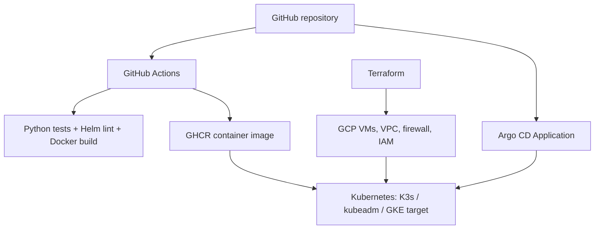

# Cloud Native Infrastructure

[](https://github.com/Fouad-DevOps-Projects/cloud-native-infrastructure/actions/workflows/sample-api-ci.yml)
[](https://github.com/Fouad-DevOps-Projects/cloud-native-infrastructure/actions/workflows/security.yml)

**Terraform-managed Kubernetes infrastructure on Google Cloud, with captured operational evidence and a GitOps-ready sample application.**

## Architecture



## Scope and outcomes

| Component | Implementation | Evidence |
|---|---|---|
| GCP K3s | Terraform provisioning, container operations, failure tests | [K3s records](docs/evidence/k3s/) |
| Three-node kubeadm | Kubernetes 1.36.6, Calico VXLAN, services and DNS | [Kubeadm records](docs/evidence/kubeadm/) |
| Rollout / rollback | Probes, rolling updates, rollback of invalid image | [Kubeadm records](docs/evidence/kubeadm/) |
| Node maintenance | Drain, evacuation and uncordon | [Runbooks](docs/runbooks/kubeadm/) |
| Worker outage | Automatic replacement following node unavailability | [Worker-failure evidence](docs/evidence/kubeadm/worker-failure/) |
| Sample API | FastAPI, live/ready endpoints, tests, non-root container | [Application](apps/sample-api/) |
| CI/CD | GitHub Actions test, Helm lint, Docker build, GHCR publication | [Workflows](.github/workflows/) |
| GitOps | Helm chart and Argo CD Application manifest | [Helm](helm/sample-api/) · [Argo CD](argocd/applications/sample-api.yaml) |
| Validation | Historical versus pending evidence explicitly distinguished | [Evidence register](docs/validation/README.md) |

**Evidence integrity:** K3s and kubeadm test output was captured from real GCP clusters; they have since been destroyed to limit cloud cost. The new application workflows and GitOps configuration are code artifacts; successful pipeline and live Argo CD deployment results must be confirmed in GitHub Actions/a running cluster. GKE, Prometheus and Grafana are architectural follow-on work rather than demonstrated deployments.

## Run locally

```bash
cd apps/sample-api
python -m venv .venv
source .venv/bin/activate
pip install -r requirements-dev.txt
python -m pytest -v
uvicorn main:app --host 0.0.0.0 --port 8080
curl http://localhost:8080/health/ready
```

Docker:

```bash
docker build -t sample-api:local apps/sample-api
docker run --rm -p 8080:8080 sample-api:local
```

## Deploy with Helm

Requires an accessible Kubernetes cluster, Helm and a published accessible image:

```bash
helm lint helm/sample-api
helm template sample-api helm/sample-api
helm upgrade --install sample-api helm/sample-api --namespace sample-api --create-namespace
kubectl rollout status deployment/sample-api-sample-api -n sample-api
kubectl port-forward svc/sample-api-sample-api 8080:80 -n sample-api
```

The chart's default GHCR image is published by the `Publish Sample API Image` workflow on main. If the package is private, configure image pull credentials or change package visibility before attempting deployment. For a reproducible release, override `image.tag` with an immutable commit SHA tag rather than `latest`.

## Deploy with Argo CD

After installing Argo CD into the cluster:

```bash
kubectl apply -f argocd/applications/sample-api.yaml
kubectl get applications -n argocd
```

The Application points to `helm/sample-api` on main and creates namespace `sample-api`. This is a declarative deployment definition, not a claim of completed live synchronization.

## Repository layout

```text
.github/workflows/             automated CI and GHCR publishing
apps/sample-api/               FastAPI application, tests, Dockerfile
helm/sample-api/               Kubernetes application Helm chart
argocd/applications/           GitOps Application definition
terraform/environments/        GCP infrastructure environments
kubernetes/                    K3s, kubeadm and Kubernetes manifests
docs/architecture/             architecture and delivery design
docs/evidence/                 captured historical lab evidence
docs/runbooks/                 operating and failure recovery procedures
docs/validation/               evidence register and verification gaps
```

## Cost controls and lifecycle

Infrastructure is provisioned from Terraform and destroyed after evidence capture. The documented kubeadm lab teardown completed with **10 resources destroyed**, an empty Terraform state and zero Compute Engine instances in the GCP project. Destroying clusters does not erase the committed infrastructure definitions or test evidence.

## Portfolio highlights

- Independently provisioned a three-node Kubernetes cluster with Terraform, networking and IAM security on GCP.
- Diagnosed cross-node traffic and tested service discovery, deployment rollbacks, planned drain and unplanned worker outage.
- Captured controller-driven replacement of two Pods and restoration of three available replicas.
- Added containerized application, automated test/build workflows, Helm packaging and GitOps manifests.
- Practiced cloud cost hygiene by tearing down tested resources and retaining reproducible documentation.

See [delivery architecture](docs/architecture/delivery-pipeline.md) and the [validation register](docs/validation/README.md) for exact verification status.
