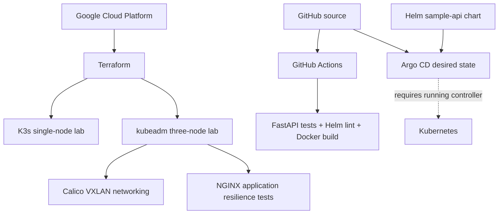

# Cloud Native Infrastructure


**Infrastructure-as-code, self-managed Kubernetes operations, a containerized API, Helm, and GitOps delivery manifests on Google Cloud.**

This repository is designed as a reproducible DevOps/platform-engineering portfolio project. It combines **actual captured GCP lab evidence** with **version-controlled application-delivery implementation**. Features that have not been deployed or validated are not presented as completed production deployments.

## Architecture



See [application delivery architecture](docs/architecture/delivery-pipeline.md).

## What's included

| Area | Implementation | Evidence |
|---|---|---|
| K3s | Terraform-provisioned GCP lab, app deployment and failure validation | [K3s evidence](docs/evidence/k3s/) |
| kubeadm | Three-node Kubernetes v1.36.6 cluster, Calico VXLAN, DNS and ClusterIP | [Kubeadm evidence](docs/evidence/kubeadm/) |
| Kubernetes reliability | Readiness/liveness probes, rolling update, rollback, drain, worker outage and recovery | [Worker-failure runbook](docs/runbooks/kubeadm/worker-failure-recovery.md) |
| Sample API | FastAPI endpoints, Dockerfile, unit/integration-style endpoint tests | [Source](apps/sample-api/) |
| CI | GitHub Actions tests, Helm lint/template, container build | [Workflow](.github/workflows/sample-api-ci.yml) |
| Helm | Parametrized Deployment and ClusterIP Service with probes and security context | [Chart](helm/sample-api/) |
| GitOps | Declarative Argo CD Application, automated sync and self-heal | [Application manifest](argocd/applications/sample-api.yaml) |

## Run the sample API locally

```bash
cd apps/sample-api
python3 -m venv .venv
source .venv/bin/activate
pip install -r requirements-dev.txt
python -m pytest -v
uvicorn main:app --reload --port 8080
curl http://127.0.0.1:8080/health/ready
```

Docker:
```bash
docker build -t sample-api:local apps/sample-api
docker run --rm -p 8080:8080 sample-api:local
```

Helm validation:
```bash
helm lint helm/sample-api
helm template sample-api helm/sample-api
```

To deploy, publish a container image to an accessible registry, set `image.repository` and `image.tag` in the Helm values, and apply the chart to a Kubernetes cluster. The default registry/image reference is **not proof an image has been published**. Argo CD configuration requires a running Argo CD installation and a target cluster; a working sync is not claimed without evidence.

## Evidence integrity and cloud costs

- Real GCP infrastructure tests were executed and saved under `docs/evidence/` before Terraform teardown.
- The [worker-outage experiment](docs/runbooks/kubeadm/worker-failure-recovery.md) recorded a drop to 1/3 available replicas, automatic replacement on a healthy worker, then restoration to 3/3.
- The original three-node GCP cluster was **destroyed after evidence collection**; these URLs/configs are not currently a live cluster.
- GitHub Actions results and badges reflect actual GitHub workflow execution, not simulated tests.
- GKE and observability are roadmap candidates, not claimed completed implementations.

## Technology stack

GCP · Terraform · Kubernetes · K3s · kubeadm · Calico · Docker · Python/FastAPI · Helm · Argo CD · GitHub Actions

## Project layout

```text
apps/sample-api/               FastAPI source, tests and Dockerfile
helm/sample-api/               Helm application chart
argocd/applications/           Argo CD desired state
.github/workflows/             CI automation
terraform/environments/        GCP infrastructure configurations
kubernetes/                    Kubernetes manifests
docs/evidence/                 Captured real cluster test results
docs/runbooks/                 Operations and incident documentation
docs/architecture/             Architecture and delivery diagrams
```

## Status

**Historical GCP K3s/kubeadm validation complete, with committed evidence.** Application-delivery artifacts are implemented; refer to the GitHub Actions workflow for their actual validation status. A live GKE deployment or Argo CD sync has not been verified.
