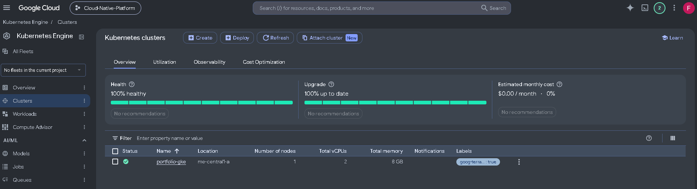
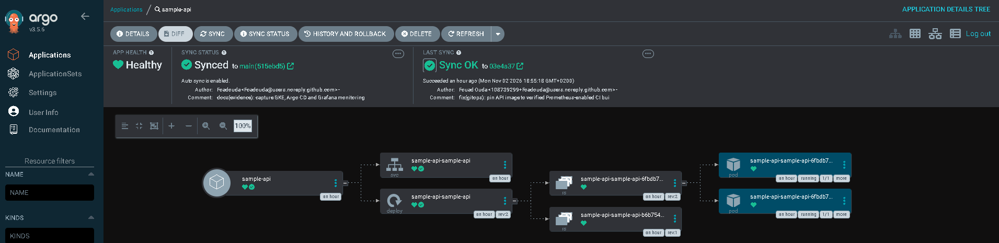
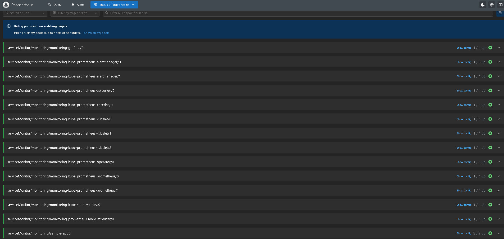
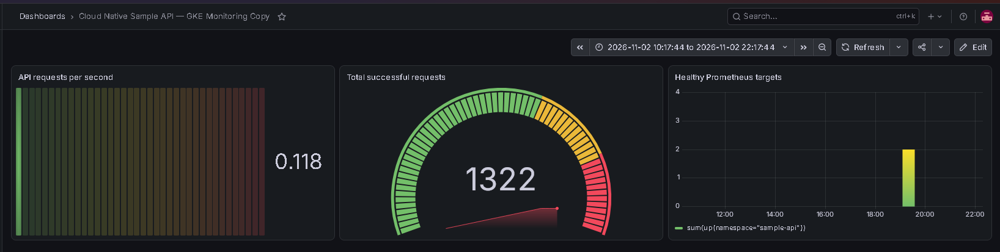
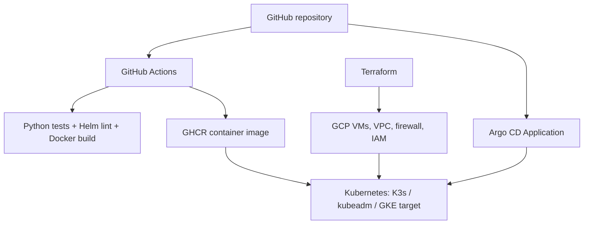

# Cloud Native Infrastructure

[](https://github.com/Fouad-DevOps-Projects/cloud-native-infrastructure/actions/workflows/sample-api-ci.yml)
[](https://github.com/Fouad-DevOps-Projects/cloud-native-infrastructure/actions/workflows/security.yml)

**Terraform-managed Kubernetes on Google Cloud, experimentally validated cluster resilience, and a tested CI/CD + security pipeline with Helm/Argo CD GitOps configuration.**

**[GKE deployment & screenshot gallery](docs/evidence/gke/README.md) · [Architecture diagrams](docs/architecture/portfolio-overview.md) · [All evidence](docs/evidence/README.md) · [CI run](https://github.com/Fouad-DevOps-Projects/cloud-native-infrastructure/actions/runs/41469595769) · [Security run](https://github.com/Fouad-DevOps-Projects/cloud-native-infrastructure/actions/runs/41471185759)**

## Verified deployment showcase — November 2026

A Google Kubernetes Engine **zonal Standard cluster** was provisioned with Terraform. Argo CD reconciled the application from GitHub to **Synced / Healthy**, with **2/2 FastAPI Pods running**. The application image was pulled from a private GHCR package through a Kubernetes image-pull Secret. Prometheus discovered and scraped **2/2 API endpoints** through a ServiceMonitor; Grafana displayed real request metrics.

### GKE · GitOps · Prometheus · Grafana

| GKE infrastructure | GitOps: Synced + Healthy |
|---|---|
| [](docs/evidence/gke/gke-cluster-overview.png) | [](docs/evidence/gke/argocd-resource-tree.png) |
| **Prometheus: both API targets UP** | **Grafana: live metrics dashboard** |
| [](docs/evidence/gke/prometheus-targets.png) | [](docs/evidence/gke/grafana-dashboard.png) |

[**Open the complete evidence gallery and raw test outputs →**](docs/evidence/gke/README.md)

> **Deployment lifecycle:** The screenshots and Kubernetes outputs record the successful November 2026 deployment. On **3 November 2026**, Terraform destroyed the GKE node pool and cluster (2 resources). Independent checks found an empty Terraform state and no remaining GKE clusters, VMs, persistent disks, reserved IPs, forwarding rules or snapshots. The separately created Secret Manager secret was subsequently deleted, including its three stored versions. The underlying GHCR token's revocation and project-wide billing status were not verified. [Teardown verification](docs/evidence/gke/teardown/README.md). No registry credentials are stored in Git.


## Architecture



## Scope and outcomes

| Component | Implementation | Evidence |
|---|---|---|
| GCP K3s | Terraform provisioning, container operations, failure tests | [K3s records](docs/evidence/k3s/) |
| Three-node kubeadm | Kubernetes 1.36.6, Calico VXLAN, services and DNS | [Kubeadm records](docs/evidence/kubeadm/) |
| Rollout / rollback | Probes, rolling updates, rollback of invalid image | [Kubeadm records](docs/evidence/kubeadm/) |
| Node maintenance | Drain, evacuation and uncordon | [Runbooks](docs/runbooks/kubeadm/) |
| Worker outage | Automatic replacement following node unavailability | [Worker-failure evidence](docs/evidence/kubeadm/worker-failure/) |
| Sample API | FastAPI, live/ready endpoints, tests, non-root container | [Application](apps/sample-api/) |
| CI/CD | GitHub Actions test, Helm lint, Docker build, GHCR publication | [Workflows](.github/workflows/) |
| GitOps | Helm chart and Argo CD Application manifest | [Helm](helm/sample-api/) · [Argo CD](argocd/applications/sample-api.yaml) |
| CI validation | API test, Helm and image jobs passed | [Successful workflow](https://github.com/Fouad-DevOps-Projects/cloud-native-infrastructure/actions/runs/41469595769) |
| Security validation | Active IaC and workload scans passed; historical findings archived separately | [Successful security workflow](https://github.com/Fouad-DevOps-Projects/cloud-native-infrastructure/actions/runs/41471185759) |
| Validation | Recorded deployment tests and operational evidence | [Evidence register](docs/validation/README.md) |

**Evidence integrity:** K3s and kubeadm test output was captured from real GCP clusters, later destroyed to limit cost. In November 2026, a live GKE lab validated Argo CD synchronization, FastAPI deployments, Prometheus scraping and Grafana visualization. The evidence gallery contains the recorded outputs and screenshot. GKE teardown was verified on 3 November 2026; historic screenshots are evidence of the former deployment, not a currently running service.

## Run locally

```bash
cd apps/sample-api
python -m venv .venv
source .venv/bin/activate
pip install -r requirements-dev.txt
python -m pytest -v
uvicorn main:app --host 0.0.0.0 --port 8080
curl http://localhost:8080/health/ready
```

Docker:

```bash
docker build -t sample-api:local apps/sample-api
docker run --rm -p 8080:8080 sample-api:local
```

## Deploy with Helm

Requires an accessible Kubernetes cluster, Helm and a published accessible image:

```bash
helm lint helm/sample-api
helm template sample-api helm/sample-api
helm upgrade --install sample-api helm/sample-api --namespace sample-api --create-namespace
kubectl rollout status deployment/sample-api-sample-api -n sample-api
kubectl port-forward svc/sample-api-sample-api 8080:80 -n sample-api
```

The chart's default GHCR image is published by the `Sample API CI and Image Publishing` workflow on main. If the package is private, configure image pull credentials or change package visibility before attempting deployment. For a reproducible release, override `image.tag` with an immutable commit SHA tag rather than `latest`.

## Deploy with Argo CD

After installing Argo CD into the cluster:

```bash
kubectl apply -f argocd/applications/sample-api.yaml
kubectl get applications -n argocd
```

The Application tracks `helm/sample-api` on main. A live GKE deployment was verified **Synced / Healthy** with two running Pods; see [GKE evidence](docs/evidence/gke/README.md). The registry image is private, so the named `ghcr-pull` Secret must be created separately in each target cluster.

## Repository layout

```text
.github/workflows/             automated CI and GHCR publishing
apps/sample-api/               FastAPI application, tests, Dockerfile
helm/sample-api/               Kubernetes application Helm chart
argocd/applications/           GitOps Application definition
terraform/environments/        GCP infrastructure environments
kubernetes/                    K3s, kubeadm and Kubernetes manifests
docs/architecture/             architecture and delivery design
docs/evidence/                 captured historical lab evidence
docs/runbooks/                 operating and failure recovery procedures
docs/validation/               deployment validation and evidence register
```

## Cost controls and lifecycle

Infrastructure was provisioned using Terraform and decommissioned after evidence capture. The earlier kubeadm lab teardown removed **10 managed resources**. The GKE lab was independently verified decommissioned on **3 November 2026**: Terraform reported **2 resources destroyed**, its state was empty, and checks showed no GKE clusters, Compute Engine VMs, disks, reserved IPs, forwarding rules or snapshots. The separately created GCP Secret Manager secret was also deleted, including its three versions. This does **not** establish a zero-cost cloud account or verify revocation of its underlying GHCR token. [Read the GKE teardown record](docs/evidence/gke/teardown/README.md).

## Portfolio highlights

- Independently provisioned a three-node Kubernetes cluster with Terraform, networking and IAM security on GCP.
- Diagnosed cross-node traffic and tested service discovery, deployment rollbacks, planned drain and unplanned worker outage.
- Captured controller-driven replacement of two Pods and restoration of three available replicas.
- Added containerized application, automated test/build workflows, Helm packaging and GitOps manifests.
- Practiced cloud cost hygiene by tearing down tested resources and retaining reproducible documentation.

See [end-to-end architecture](docs/architecture/portfolio-overview.md), [evidence index](docs/evidence/README.md), [delivery architecture](docs/architecture/delivery-pipeline.md), and the [validation register](docs/validation/README.md) for verification status.
