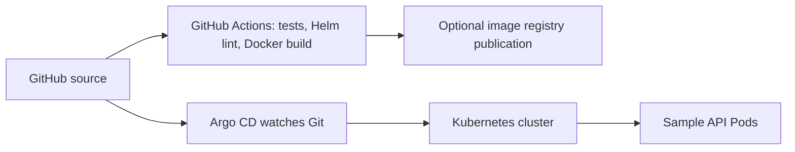

# Application Delivery Architecture

## Scope and verification

The sample API, container build, tests, Helm manifests, and Argo CD Application are defined in this repository.
The CI workflow validates tests, Helm rendering and Docker build on pull requests and pushes.
CI does **not** publish images or deploy into a live cluster.
The Helm default image path is a convention: it requires an image to be published before deployment.
Argo CD needs a running cluster and an installed Argo CD controller. No live Argo CD sync is claimed.

## Verified historical Kubernetes evidence

See `docs/evidence/kubeadm/` and `docs/evidence/k3s/`.
These results were captured from real GCP labs before their Terraform teardown.
