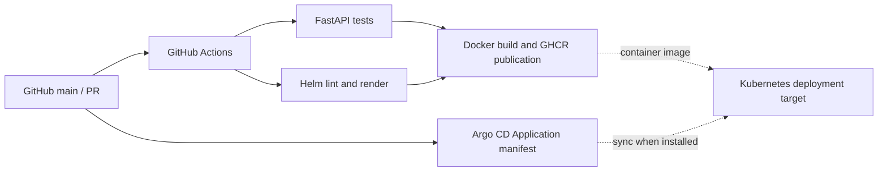

# Cloud-Native Infrastructure — Architecture and Lifecycle

This project demonstrates infrastructure-as-code, Kubernetes operations, automated delivery, GitOps configuration, security scanning, and observability integration designs on Google Cloud Platform.

> **Lifecycle:** The real K3s and kubeadm clusters used for the experiments were destroyed after evidence collection. GKE, Argo CD and monitoring components are provided as deployment configurations; there is no claim that they have been deployed to a live environment.

## 1. Infrastructure experiments: verified

### K3s on Compute Engine

- Cloud: GCP, region `me-central1`, zone `me-central1-a`.
- Terraform-provisioned Ubuntu VM, dedicated VPC and subnet (`10.20.0.0/24`), IAP-restricted SSH.
- K3s cluster and application validation, including Deployments, ConfigMaps, Secrets, probes and troubleshooting.
- Evidence: [K3s status](../evidence/k3s/cluster-status.txt), [K3s manifests](../../kubernetes/k3s/).

### Three-node kubeadm cluster on Compute Engine

- GCP Ubuntu 24.04, Kubernetes v1.36.6, containerd v2.2.1, Calico VXLAN.
- Control plane `10.30.0.10`, worker 1 `10.30.0.11`, worker 2 `10.30.0.12`.
- VPC subnet `10.30.0.0/24`, SSH through IAP, Kubernetes API accessed internally.
- Validated cross-node traffic, ClusterIP, CoreDNS, rolling deployments and rollback.
- Tested graceful node draining and unplanned worker outage. After the default 300-second toleration, two replacement Pods were created on worker 2 while worker 1 remained NotReady. Workload availability returned to 3/3 replicas.
- Evidence: [kubeadm records](../evidence/kubeadm/), [worker failure](../evidence/kubeadm/worker-failure/), [runbook](../runbooks/kubeadm/worker-failure-recovery.md).

## 2. Application delivery: implemented and verified in GitHub Actions

- [FastAPI application](../../apps/sample-api/) exposes liveness, readiness and Prometheus metrics.
- [CI and image publishing](../../.github/workflows/sample-api-ci.yml) passed [run #6](https://github.com/Fouad-DevOps-Projects/cloud-native-infrastructure/actions/runs/41469595769), including `test`, `helm` and `image` jobs.
- [Helm chart](../../helm/sample-api/) defines the Deployment and ClusterIP Service with resource requests/limits and non-root security defaults.
- [Argo CD Application](../../argocd/applications/sample-api.yaml) is declarative and has **not** been proven synchronized with a live cluster.

## 3. Security controls and audit boundary

- [Security workflow](../../.github/workflows/security.yml) validates repository dependencies/secrets, active GKE configuration, and Helm-rendered workload configuration.
- A separate, non-blocking archive captures misconfiguration findings from older lab manifests and historical Terraform.
- The security workflow passed [run #18](https://github.com/Fouad-DevOps-Projects/cloud-native-infrastructure/actions/runs/41471185759).
- Historical manifests are intentionally retained as an accurate record of the original exercises; they are not presented as production-hardened templates.
- Terraform variables, state files, deployment secrets and SSH keys are excluded from Git.

## 4. Provisioned vs configuration-only resources

| Component | Evidence status |
|---|---|
| K3s cluster | Previously running; captured evidence |
| Three-node kubeadm + Calico | Previously running; captured evidence |
| Node drain, rollback, worker recovery | Previously tested; captured evidence |
| FastAPI tests, Helm lint, Docker build, GHCR publication | Passed in GitHub Actions |
| Trivy security checks | Passed in GitHub Actions for active configuration |
| GKE Terraform | Defined and security-scanned; no live cluster evidence |
| Argo CD GitOps | Defined; no live synchronization evidence |
| Prometheus / Grafana | Configuration only; no successful live scrape/dashboard evidence |

## 5. Repeatability and cost

Source-of-truth infrastructure configurations are in [Terraform environments](../../terraform/environments/). Recreate only after reviewing the Terraform plan and Google Cloud billing exposure.

The completed kubeadm lab was destroyed with Terraform: 10 resources removed, state emptied and zero GCP Compute Engine VMs remained at verification. These past findings document an exercise result, not a live infrastructure status guarantee.

See the [application delivery runbook](../runbooks/application-delivery.md) and [validation register](../validation/README.md) for commands and evidence limitations.
