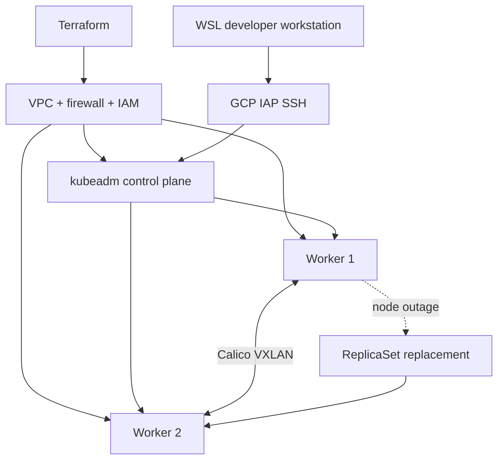
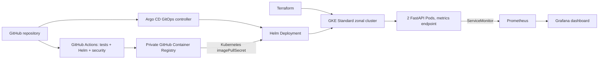

# Architecture and verification map

## Self-managed Kubernetes experiments (historical)

The earlier K3s and Kubernetes v1.36.6 three-node kubeadm environments were tested on Compute Engine and later destroyed. See [historical evidence](../evidence/README.md).

## Verified GKE delivery and observability (November 2026)

The live experiment reached **Argo CD Synced / Healthy**, **2/2 FastAPI Pods Ready**, **2/2 Prometheus scrape targets UP**, and a working Grafana dashboard. [Open the screenshot gallery](../evidence/gke/README.md).

- [Successful application CI run](https://github.com/Fouad-DevOps-Projects/cloud-native-infrastructure/actions/runs/41469595769).
- [Successful security scan](https://github.com/Fouad-DevOps-Projects/cloud-native-infrastructure/actions/runs/41471185759).
- Historical laboratory security findings are preserved as separate report-only artifacts.

**Lifecycle:** Screenshots show a running environment at the time of capture. Final Terraform teardown has not yet been verified; ongoing availability is not promised.
