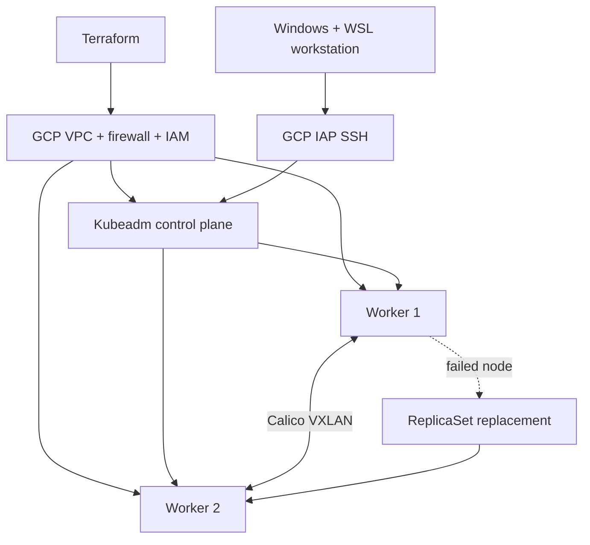
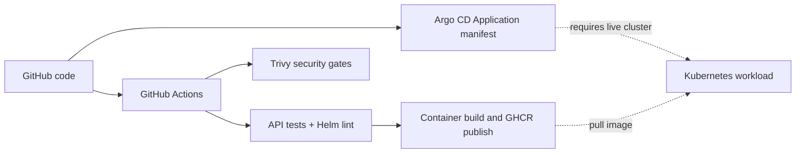

# Architecture and verification map

## Historically deployed Kubernetes environment

Kubernetes v1.36.6, three Compute Engine VMs, Calico VXLAN, CoreDNS and containerd were tested on GCP. The earlier K3s single-node lab was also tested. Both labs were destroyed after capturing experiment evidence.

## Implemented application delivery

- CI [run #6](https://github.com/Fouad-DevOps-Projects/cloud-native-infrastructure/actions/runs/41469595769) completed successfully: tests, Helm and image jobs.
- Security [run #18](https://github.com/Fouad-DevOps-Projects/cloud-native-infrastructure/actions/runs/41471185759) completed successfully.
- Helm chart, Argo CD Application, GKE Terraform and kube-prometheus-stack configuration are repository artifacts. No successful live GKE provisioning, Argo CD sync or Grafana visualization is claimed.
- Historical lab security findings are preserved as a report-only artifact. Active configuration misconfiguration checks remain blocking.

See [Evidence](../evidence/README.md) and [Validation](../validation/README.md).
