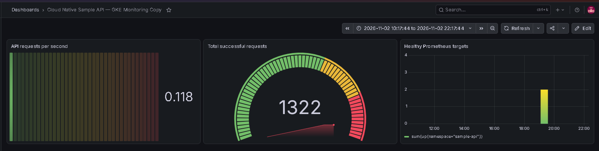
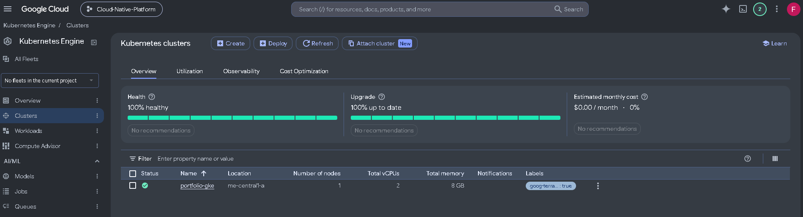
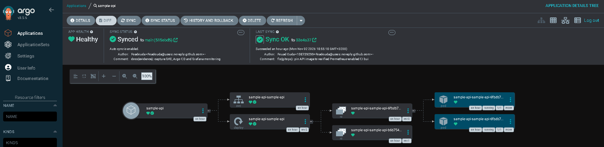
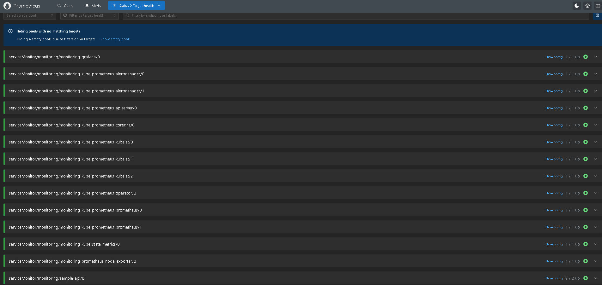

# GKE Deployment — Visual Evidence Gallery

[← Main portfolio README](../../../README.md) · [Architecture](../../architecture/portfolio-overview.md) · [Evidence index](../README.md)

This gallery documents the **real GKE, Argo CD, private GHCR, Prometheus and Grafana deployment** validated in November 2026. The lab was **successfully decommissioned on 3 November 2026** after testing; these screenshots are evidence of the deployed environment, not a currently running cluster. [Verified teardown record](teardown/README.md).

## Observability: Grafana dashboard

*Actual Grafana dashboard from GKE. API request rate, HTTP status counters and two healthy scrape targets were displayed. Counter values include health checks and are snapshots, not lifetime traffic totals.*

## Live deployment evidence

| Stage | Observed verification | Captured artifacts |
|---|---|---|
| GKE Standard cluster | Single zonal cluster, one worker Ready, 2 vCPUs and 8 GiB RAM | [Node output](nodes.txt), [Version](kubernetes-version.txt) |
| Argo CD GitOps | Application Synced / Healthy, two running Pods | [Argo CD status](argocd-applications.txt), [Argo CD components](argocd-pods.txt) |
| Private GHCR image | Authenticated image pull using Kubernetes Secret; immutable SHA image deployed | [Deployed image](deployed-image.txt), [Deployment status](sample-api-resources.txt) |
| Prometheus Operator | 2 / 2 FastAPI targets scraped, metric series returned | [Prometheus query JSON](prometheus-query.json), [ServiceMonitor](servicemonitor.yaml) |
| Grafana | Dashboard with three live panels | [Grafana screenshot](grafana-dashboard.png) |
| Monitoring stack | Prometheus, Grafana, Alertmanager and exporters running | [Monitoring Pods](monitoring-pods.txt) |

## Visual deployment walkthrough

### 1. Google Kubernetes Engine — provisioned with Terraform

*GKE Standard zonal cluster, one healthy node with 2 vCPUs and 8 GiB memory.*

### 2. Argo CD — Synced and Healthy

*Live GitOps reconciliation from the Helm chart in GitHub. Resource tree shows the Service, Deployment, ReplicaSets and two running API Pods.*

### 3. Prometheus — API scraping verified

*The `sample-api` ServiceMonitor found both Pods and Prometheus successfully scraped their `/metrics` endpoints.*

### 4. Grafana — application metrics

*Captured request rate, HTTP 200 counters and two healthy scrape targets. The counter includes probes and is not a lifetime request total.*

## Reproducible supporting output

| Evidence | Captured file |
|---|---|
| GKE node and Kubernetes version | [Nodes](nodes.txt) · [Version](kubernetes-version.txt) |
| Healthy Argo CD application | [Application status](argocd-applications.txt) · [Argo CD Pods](argocd-pods.txt) |
| Application rollout and private GHCR image | [Deployment and Pods](sample-api-resources.txt) · [Pinned image](deployed-image.txt) |
| Actual scraped API metrics | [Prometheus API response](prometheus-query.json) · [Sample API metrics](sample-api-metrics.txt) |
| Monitoring stack | [Monitoring Pods](monitoring-pods.txt) · [ServiceMonitor spec](servicemonitor.yaml) |

**Credential safety:** Do not upload GitHub PATs, `argocd-initial-admin-secret`, kubeconfig, Terraform state, or Grafana passwords. Image pull credentials remain inside Kubernetes and are not stored in Git.

**Teardown verified:** Terraform reported **2 resources destroyed** on 3 November 2026. The state was empty; GCP checks showed no GKE cluster, VM, disk, reserved IP, forwarding rule or snapshot. [Verification and remaining separate secret](teardown/README.md). This does not imply every cloud service or billing item is absent.
